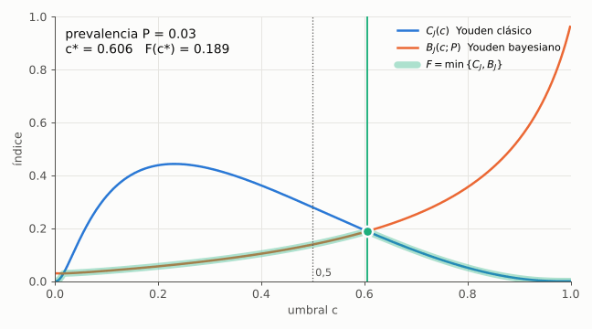
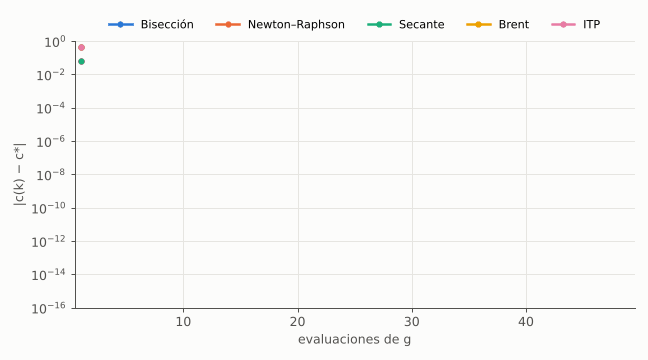
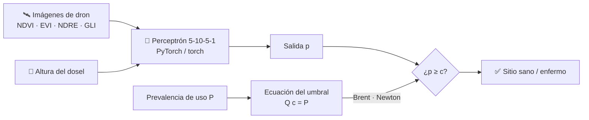

<div align="center">


<a href="#-la-idea-en-una-animación">

</a>

<p>


</p>

</div>

---

## 🎯 La idea en una animación

Una red con salida logística entrega una probabilidad, y casi siempre se corta en **0,5**.
Ese umbral ignora la prevalencia. El umbral propuesto

$$c^{*}=\arg\max_{c}\ \min\{C_J(c),\;B_J(c;P)\}$$

es el punto donde se cruzan el índice de Youden **clásico** (la red como instrumento) y el
**bayesiano** (lo que aprende quien recibe la predicción). Es la única raíz de $Q(c)=P$:
**se igualan los falsos positivos y los falsos negativos esperados**.

<div align="center">

<br><sub>Al cambiar la prevalencia de uso <i>P</i>, el cruce de C<sub>J</sub> y B<sub>J</sub> —y con él c*— se desplaza. La línea punteada es el umbral por defecto 0,5.</sub>
</div>

## ⚡ Cinco métodos para resolver la ecuación del umbral

<div align="center">

<br><sub>Error en cada evaluación: Newton–Raphson (cuadrático) y Brent (robusto) son los métodos retenidos.</sub>
</div>

## 🧭 Flujo de trabajo



## 🚀 Uso rápido

<details open>
<summary><b>🐍 Python + PyTorch + Shiny</b></summary>

```bash
sudo apt install python3-venv python3-full        # solo la primera vez (Ubuntu/Debian)
python3 -m venv .venv
source .venv/bin/activate                          # desde aquí, pip instala solo dentro de .venv
# PyTorch SOLO para CPU (≈200 MB, sin controladores de video ni tarjeta gráfica)
pip install torch --index-url https://download.pytorch.org/whl/cpu
pip install -r requirements.txt
pytest -q                       # reproduce las tablas 2, 3, 5 y 6 del artículo
shiny run --reload app/app.py   # abre http://127.0.0.1:8000 en el navegador
```
Cada vez que abras una terminal nueva, activa el entorno con `source .venv/bin/activate`.
</details>

<details>
<summary><b>📊 R + Shiny + torch (diseño bslib)</b></summary>

Desde la **terminal** (no dentro de R):
```bash
sudo apt install r-base libcurl4-openssl-dev libssl-dev libxml2-dev   # solo la primera vez
Rscript app_r/instalar.R          # una sola vez; torch se instala en versión CPU
Rscript -e 'shiny::runApp("app_r", launch.browser = TRUE)'
```
O dentro de la consola de R / RStudio, con el repositorio como carpeta de trabajo:
```r
source("app_r/instalar.R")
shiny::runApp("app_r")
```
</details>

<details>
<summary><b>🟩 ¿Tienes GPU NVIDIA? (opcional)</b></summary>

Por defecto todo corre en **CPU**: la red tiene 121 parámetros y entrena en segundos,
así que la GPU no es necesaria (con redes tan pequeñas incluso puede ser más lenta).
Si quieres usarla:

| | Instalación | Uso |
| --- | --- | --- |
| **Python** | `pip install torch` (versión CUDA, varios GB) con los controladores NVIDIA instalados | En la app: *Dispositivo → GPU NVIDIA si está disponible*; en código: `RedTorch(dispositivo="auto")` o `"cuda"` |
| **R** | `torch::install_torch()` en un equipo con CUDA | En la app: *Dispositivo → GPU*; en código: `entrenar_red(..., dispositivo = "auto")` |

Con `"auto"`, si no hay GPU se usa la CPU sin error.
</details>

## 🗂️ Contenido

| Ruta | Qué hace |
| --- | --- |
| `src/umbral/metricas.py` | Se, Sp, VPP, VPN, C<sub>J</sub>, B<sub>J</sub>, B<sub>G</sub>, F<sub>1</sub>, MCC y la proposición 3 |
| `src/umbral/binormal.py` | Modelo logit-binormal reconstruido desde la matriz de confusión |
| `src/umbral/raices.py` | Bisección, Newton–Raphson, secante, Brent e ITP |
| `src/umbral/umbral.py` | c* desde la matriz (modelo) o desde los puntajes (cuantil 1 − P) |
| `src/umbral/red_torch.py` | Perceptrón 5-10-5-1 en PyTorch (sección 4.3 del artículo) |
| `src/umbral/validacion.py` | Validación cruzada estratificada y **agrupada por ubicación** |
| `src/umbral/sinteticos.py` | Datos sintéticos con la estructura del experimento |
| `app/app.py` | App Shiny para Python |
| `app_r/app.R` | App R Shiny en un solo archivo (bslib, plotly y torch para R) |
| `tools/generar_animaciones.py` | Regenera los GIF de este README |

## 🖥️ La app

| Pestaña | Contenido |
| --- | --- |
| **1 · Desde la matriz** | c*, modelo logit-binormal, tabla de los cuatro umbrales, proposición 3 |
| **2 · Métodos numéricos** | Comparación de los cinco métodos y su convergencia |
| **3 · Datos y red** | Entrena la red con datos sintéticos o con tu CSV local; CV estratificada vs. agrupada |
| **4 · Cambio de prevalencia** | c*(P) para varios valores de κ |

## 🔒 Datos

Los datos de campo **no se publican**: `data/` y todos los `.csv` están excluidos por
`.gitignore`. El CSV se carga solo en la app que corre en tu computador. Ver `data/README.md`.

## 👤 Autor

**Jesús Enrique Flores Riera** · [ORCID 0000-0002-8167-4212](https://orcid.org/0000-0002-8167-4212)
Universidad Nacional de Colombia

<div align="center">

</div>
